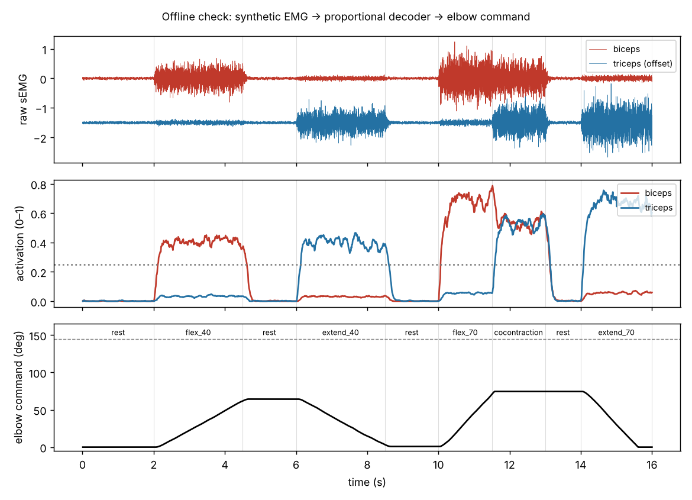

# prosthetic_elbow_sim

A simulated EMG-controlled **transhumeral prosthetic elbow** for ROS 2 + Gazebo.

```
emg_simulator / emg_csv_player ──/emg/raw──► emg_decoder ──/elbow_position_controller/commands──► Gazebo elbow
   (synthetic or your recording)             (RMS envelope →        (ros2_control,                 (1-DoF, 0–145°)
                                              proportional control)  gz_ros2_control)
```

- **Elbow model** (`urdf/elbow.urdf.xacro`): upper arm (residual limb + socket), 1-DoF revolute elbow
  (flexion/extension, 0–145°, 12 Nm, ~200°/s), forearm and terminal device with realistic mass/inertia.
- **Decoder** (`emg_decoder`): conventional two-site proportional myoelectric control.
  Biceps → flexion velocity, triceps → extension velocity, deadband, **co-contraction = hold**.
- **EMG sources**: `emg_simulator` (synthetic biceps/triceps sEMG with a looping task:
  rest → flex 40% → extend 40% → flex 70% → co-contraction → extend 70%) or `emg_csv_player`
  (replays your own recording).
- `decoder_core.py` and `synthetic_emg.py` contain no ROS code, so you can reuse them offline (Jupyter, MATLAB comparisons) and test them with `pytest`.



## 1. Install dependencies

Written for **ROS 2 Jazzy + Gazebo Harmonic** (Ubuntu 24.04). Check your distro with `echo $ROS_DISTRO`.

```bash
sudo apt update
sudo apt install ros-$ROS_DISTRO-ros-gz ros-$ROS_DISTRO-gz-ros2-control \
                 ros-$ROS_DISTRO-ros2-controllers ros-$ROS_DISTRO-xacro \
                 ros-$ROS_DISTRO-robot-state-publisher
```

**On Humble (Ubuntu 22.04, Gazebo Fortress)?** Install `ros-humble-ign-ros2-control` instead of
`gz-ros2-control`, and in `urdf/elbow.urdf.xacro` change:

| Jazzy / Harmonic | Humble / Fortress |
|---|---|
| `gz_ros2_control/GazeboSimSystem` | `ign_ros2_control/IgnitionSystem` |
| `filename="gz_ros2_control-system"` | `filename="ign_ros2_control-system"` |
| `name="gz_ros2_control::GazeboSimROS2ControlPlugin"` | `name="ign_ros2_control::IgnitionROS2ControlPlugin"` |

## 2. Build

```bash
mkdir -p ~/ros2_ws/src
cp -r prosthetic_elbow_sim ~/ros2_ws/src/
cd ~/ros2_ws
colcon build --symlink-install --packages-select prosthetic_elbow_sim
source install/setup.bash
```

## 3. Run

```bash
# synthetic EMG drives the elbow (default)
ros2 launch prosthetic_elbow_sim sim.launch.py

# replay a recording (sample file included; columns: biceps,triceps)
ros2 launch prosthetic_elbow_sim sim.launch.py emg_source:=csv \
    csv_file:=$(ros2 pkg prefix prosthetic_elbow_sim)/share/prosthetic_elbow_sim/data/sample_emg.csv

# elbow only — command it yourself (angle in rad)
ros2 launch prosthetic_elbow_sim sim.launch.py emg_source:=none
ros2 topic pub --once /elbow_position_controller/commands std_msgs/msg/Float64MultiArray "{data: [1.2]}"

# no Gazebo window
ros2 launch prosthetic_elbow_sim sim.launch.py gui:=false
```

## 4. Watch and record

```bash
ros2 topic echo /elbow/mode                       # rest | flex | extend | cocontraction_hold
ros2 run rqt_plot rqt_plot /elbow/command_deg/data /emg/activation/data[0] /emg/activation/data[1]
ros2 bag record /emg/raw /emg/activation /elbow/command_deg /joint_states /emg/intended_label
```

`/joint_states` is the **actual** simulated elbow angle and `/elbow/command_deg` is the **commanded** one,
so you can compute tracking error, time-to-target, overshoot and so on.

## 5. Use your own EMG

1. Export a CSV with `biceps,triceps` columns (uniform sampling; set `emg_rate_hz`).
2. Calibrate in `config/decoder.yaml`: `rest_level` = resting RMS, `mvc` = RMS at max contraction
   (per channel, same units as the CSV).
3. Run with `emg_source:=csv csv_file:=/path/to/file.csv`.

For live sensors, write a small node that publishes interleaved `[b0, t0, b1, t1, ...]` chunks on
`/emg/raw` (std_msgs/Float64MultiArray). The decoder doesn't need any changes.

## 6. Research workflow: record, analyse, real EMG, compare decoders

See **[docs/WORKFLOW.md](docs/WORKFLOW.md)**. In short:

```bash
sudo apt install python3-sklearn python3-joblib python3-matplotlib
ros2 run prosthetic_elbow_sim record_trial --name prop --duration 32       # record a trial (rosbag)
ros2 run prosthetic_elbow_sim analyze_bags ~/elbow_recordings/prop_*        # figures + metrics.csv
ros2 run prosthetic_elbow_sim calibrate_emg my_emg.csv --out config/decoder_s01.yaml
ros2 run prosthetic_elbow_sim train_decoder my_emg.csv --model lda --out ~/elbow_models/lda.joblib
ros2 run prosthetic_elbow_sim offline_compare test.csv --models ~/elbow_models/lda.joblib
ros2 launch prosthetic_elbow_sim sim.launch.py decoder_type:=classifier model_file:=$HOME/elbow_models/lda.joblib
ros2 run prosthetic_elbow_sim simulate_subjects --subjects 6                # realistic simulated subjects
ros2 run prosthetic_elbow_sim run_study --data ~/elbow_data                 # multi-subject comparison
```

## 7. Offline tests (no ROS needed)

```bash
cd prosthetic_elbow_sim && python3 -m pytest -q test/
```

## Ideas for extending it

| Next step | Where |
|---|---|
| Regression decoder (continuous angle) or CNN | new class next to `ClassifierElbowDecoder` |
| IMU shoulder-synergy control (Mérad-style A-mode) | add `/imu` input + RBFN/ANN mapping |
| Payload & torque studies | switch the elbow to an `effort` command interface + your controller (PID / SMC / impedance) |
| Wrist rotation + hand | add joints in the xacro and controllers.yaml |
| Real hardware | replace `gz_ros2_control/GazeboSimSystem` with a hardware interface (e.g. micro-ROS on ESP32) |
